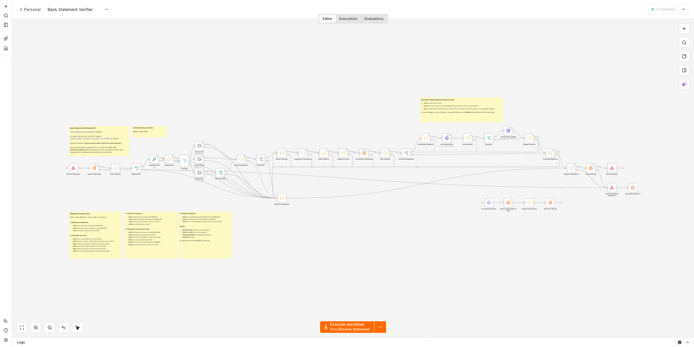
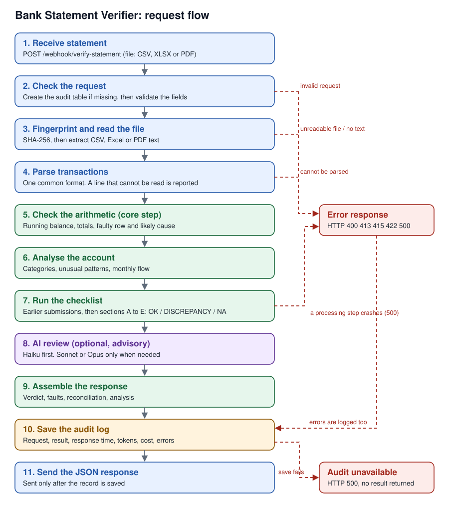

# Bank Statement Verification API

**Author:** Hasan Gaffar

## What it does

This is an API built entirely in [n8n](https://n8n.io). You upload a bank statement (CSV, XLSX or text-based PDF, up to 5 MB and 20,000 transaction lines), and it answers two questions:

1. **Do the accounts add up?**
2. **If not, where are the faults, and what is the likely cause of each?**

It recalculates the running balance and totals, compares them with the figures printed on the statement, and runs a checklist covering reading completeness, arithmetic, dates and sequence, duplicates and unusual entries, and suspicious patterns. The response contains a verdict, a reconciliation, the faulty rows, every check result and a basic account analysis. An optional AI review can add advisory notes.

## Workflow design



Further reading: [architecture](docs/ARCHITECTURE.md) · [API reference](docs/API.md) · [statement checker rules](docs/STATEMENT_RULES.md)

## Flow



| Step | What happens | n8n nodes |
|---|---|---|
| 1 | The statement arrives as a file upload | Receive Statement |
| 2 | The audit table is created if missing, and the request is validated | Ensure Audit Table, Check Request, Request OK? |
| 3 | The file is fingerprinted and read | Fingerprint File, Reattach File, File Type, Extract CSV, Extract Excel, Extract PDF, PDF Has Text? |
| 4 | Rows become one common transaction format | Parse Transactions, Parsed OK? |
| 5 | **The arithmetic is checked: running balance, totals, faulty row and likely cause** | Check Arithmetic |
| 6 | The account is analysed | Categorize Transactions, Detect Patterns, Analyse Account |
| 7 | Earlier submissions are looked up and the checklist runs | Find Earlier Submissions, Run Checklist |
| 8 | Optional AI review: Haiku first, then Sonnet or Opus only if needed | AI Review Requested?, Build Haiku Requests, Ask Claude Haiku, Route Models, Escalate?, Ask Escalation Model, Merge AI Review |
| 9 | The response is assembled | Assemble Response |
| 10 | The record is saved with response time, tokens, cost and any error | Prepare Audit Record, Save Audit Log |
| 11 | The JSON response is sent, only after the record is saved | Send Response |

**Errors.** An invalid request, an unreadable file or a crash in a processing step goes to **Build Error Response**, and is saved to the audit log before the caller gets it. If the record cannot be prepared or saved, the caller gets HTTP 500 `AUDIT_UNAVAILABLE` and no result. An **Error Trigger** is the last safety net and records other unexpected failures. Treat any response without a boolean `success` field as a failure.

## Quick start

1. Install **Node.js 22**.
2. Start n8n with `npx n8n`.
3. Open <http://localhost:5678> and complete the initial setup if asked.
4. Import `workflows/bank-statement-verifier.json`.
5. Activate (publish) the workflow.
6. Send a request from the project root:

```bash
curl -X POST http://localhost:5678/webhook/verify-statement \
  -F "statement=@sample-data/02-altered-amount.csv" \
  -F "as_of_date=2026-11-26"
```

To use Postman, import `postman/Bank-Statement-Verifier.postman_collection.json`. Its `baseUrl` variable defaults to `http://localhost:5678`. File paths in the collection are relative to the project root, so set the Postman working directory to that folder or re-select the files. With Newman installed, run this from the project root:

```bash
newman run postman/Bank-Statement-Verifier.postman_collection.json --working-dir . \
  --folder "Verification" --folder "Error handling"
```

The folder **AI review (needs Anthropic credential)** is run separately, after the [AI setup](#ai-model-routing). The files in `sample-data/` are synthetic; their names, accounts and transactions are invented.

## Use your own files with `.env`

The helper scripts contain no machine-specific paths. Anyone can run them on macOS, Linux or Windows with their own files.

1. Copy `.env.example` to `.env` in the project folder. `.env` is ignored by Git.
2. Set what you need. For your own statement, set `STATEMENT_FILE` to a path relative to the project folder, a full path on your computer, or a path starting with `~`.
3. Run:

```bash
npm run verify                          # sends STATEMENT_FILE and prints a short result
npm run verify -- path/to/statement.pdf # a file given here replaces STATEMENT_FILE
npm run e2e                             # sends every sample and compares with the expected results
```

| Variable | Default | Purpose |
|---|---|---|
| `N8N_BASE_URL` | `http://localhost:5678` | Where your n8n is running |
| `WEBHOOK_PATH` | `verify-statement` | Webhook path |
| `SAMPLE_DIR` | `sample-data` | Samples used by `npm run e2e` |
| `STATEMENT_FILE` | none | Statement sent by `npm run verify` |
| `ACCOUNT_HOLDER`, `AS_OF_DATE` | empty | Optional request fields for `npm run verify` |
| `AI_REVIEW` | `false` | `true` requests the AI review in `npm run verify` |
| `WEBHOOK_AUTH_HEADER_NAME`, `WEBHOOK_AUTH_HEADER_VALUE` | empty | For a webhook protected with Header Auth |

These settings are read by the helper scripts, not by n8n. The workflow itself receives the file in the request and needs no path. The Anthropic API key does **not** go in `.env`; add it in n8n as a credential.

## API contract

`POST /webhook/verify-statement` with `multipart/form-data`.

| Field | Required | Description |
|---|---|---|
| `statement` | Yes | The statement file: `.csv`, `.xlsx` or `.pdf`. CSV and XLSX files need date, balance and description (or type) columns, plus either debit and credit columns or amount and type columns. |
| `account_holder` | No | Up to 120 characters (longer text is cut). Used to detect the same file being submitted for a different account holder. |
| `reference` | No | Your reference, up to 60 characters (longer text is cut). Generated when omitted. |
| `as_of_date` | No | Verification date, for example `2026-11-26`. Defaults to the current date (UTC). Send it when results must be repeatable. |
| `ai_review` | No | `true` requests the AI review. Any other value, or no value, means no AI review. |

### Success response (HTTP 200)

A request returns HTTP 200 when the statement was processed, **even if faults were found**. Always check `result.verdict`.

| Property | Content |
|---|---|
| `success` | `true` |
| `reference`, `accountHolder` | Identification of the request. |
| `statement` | File name and type, SHA-256 fingerprint, period, transaction count and verification date. |
| `result` | `verdict`, `accountsCorrect` and a one-line `headline`. |
| `reconciliation` | Opening balance and its source, totals, calculated and printed figures, and the unexplained difference. |
| `faults`, `faultCount` | Running-balance faults with `row`, `date`, `description`, amounts, expected and shown balances, `difference`, `cause`, `explanation` and `summary`. At most 100 are listed; `faultCount` is the full number. |
| `verification` | Check summary, discrepancies (most severe first) and all checklist sections. |
| `analysis` | Account analysis derived from the transactions. |
| `unreadLines` | Lines that could not be read, with the reason (at most 50 listed). |
| `aiReview` | Whether a review was requested, its status and concerns; when requested, also routing and token usage with an estimated cost. |
| `processing` | `straightThrough`, the list of items for `manualHandling`, and `durationMs`. `aiReview.durationMs` is also present when a review ran. |
| `audit` | `table`, `rowId` and `loggedAt` of the audit record. |

`faultCount` counts running-balance faults only. A statement can have the verdict `FAULTS_FOUND` with a `faultCount` of 0, for example when only the printed totals are wrong. Read `verification.discrepancies` as well.

### Error response

```json
{
  "success": false,
  "reference": "...",
  "error": { "code": "MISSING_COLUMNS", "message": "..." },
  "processing": { "durationMs": 120 },
  "audit": { "table": "statement_audit_log", "rowId": 1, "loggedAt": "..." }
}
```

| HTTP | `error.code` | Meaning |
|---|---|---|
| 400 | `MISSING_FILE` | No statement file was sent. |
| 400 | `INVALID_FIELD` | `as_of_date` is not a valid date. |
| 413 | `FILE_TOO_LARGE` | The file is larger than 5 MB. |
| 413 | `TOO_MANY_ROWS` | The statement has more than 20,000 transaction lines. |
| 415 | `UNSUPPORTED_FILE_TYPE` | The file name does not end in `.csv`, `.xlsx` or `.pdf`. |
| 422 | `MISSING_COLUMNS` | Required columns were not found. |
| 422 | `OCR_REQUIRED` | The PDF has no readable text, for example a scanned image. |
| 422 | `LAYOUT_NOT_SUPPORTED` | The statement layout was not recognised. |
| 422 | `STATEMENT_UNREADABLE` | No transactions could be read, or the file may be damaged or password protected. |
| 500 | `UNEXPECTED_ERROR` | A processing step crashed. The caller gets no internal detail; the audit record names the node and the error. |
| 500 | `AUDIT_UNAVAILABLE` | The audit record could not be prepared or saved, so no result is returned. |

A failure outside the guarded steps (for example in sending the response) can leave n8n to answer by itself, possibly with an empty body. **Treat any response without a boolean `success` field as a failure.** See [Audit log](#audit-log) for how such failures are recorded.

## Verdicts and fault causes

The first matching verdict applies.

| Verdict | Meaning |
|---|---|
| `INCONCLUSIVE` | The statement could not be read reliably: no balance can be checked; or at least 3 balance checks fail and they are more than half of all checks; or more than 20% of lines are unread. This is not evidence of a fault. |
| `FAULTS_FOUND` | At least one HIGH severity discrepancy. |
| `REVIEW_REQUIRED` | At least one MEDIUM severity discrepancy and no HIGH one. A person should check it. |
| `VERIFIED` | No HIGH or MEDIUM discrepancy. LOW (information) items may still be listed. |

`result.accountsCorrect` is `false` when an arithmetic check (section B) fails, `true` when the arithmetic is correct and all lines were read, and `null` when this cannot be established.

| Fault cause | How it is recognised |
|---|---|
| `WRONG_BALANCE_FIGURE` | The next row is out by the same amount in the opposite direction. |
| `DUPLICATED_LINE` | The row repeats the previous row, including its balance. |
| `DEBIT_CREDIT_SWAPPED` | The difference is exactly twice the amount. |
| `WRONG_AMOUNT_OR_MISSING_ENTRY` | None of the above: an amount is wrong, or an entry is missing just before the row. |

A cause is a likely explanation based on the arithmetic, not a proven one. All checks, severities and reading rules are listed in [docs/STATEMENT_RULES.md](docs/STATEMENT_RULES.md).

## AI model routing

The AI review is **optional and advisory**. It never changes a check result, a figure or the verdict. It can add notes to discrepancies and raise concerns. Concerns, and a partial or unavailable review, are added to `processing.manualHandling`, which sets `processing.straightThrough` to `false`.

Haiku first reviews every checklist section. At most one second stage then follows. The rules are applied in this order (see `src/ai.js`):

| Route (`aiReview.routing.tier`) | When | Second-stage model | Sections sent to the second stage |
|---|---|---|---|
| `ESCALATED_OPUS` | 3 or more balance faults, or printed summary figures that cannot be explained, or an `INCONCLUSIVE` verdict | `claude-opus-5-5` | Sections with a HIGH or MEDIUM discrepancy, a Haiku concern or a failed Haiku reply; all sections if there are none |
| `ESCALATED_SONNET` | Otherwise, if any section has a HIGH or MEDIUM discrepancy, a Haiku concern or a failed Haiku reply | `claude-sonnet-5-5` | Those sections |
| `HAIKU_ONLY` | None of the above | None | None |

The first stage always uses `claude-haiku-5-5`. `aiReview.status` is `COMPLETED`, `PARTIAL` or `UNAVAILABLE` (`NOT_REQUESTED` when no review was asked for). A route is reported even if the model calls fail, so check the status too. If a second-stage reply fails, any usable Haiku answer is kept and the section is listed in `failedSections`.

**Setup:** create an **Anthropic** credential in n8n and select it on the two Claude HTTP Request nodes, **Ask Claude Haiku** and **Ask Escalation Model**. Save and publish the workflow again.

**Data sent to Anthropic:** for each reviewed section, the request contains the section's check results and remarks, and up to 30 transaction rows (row number, date, narration, debit, credit and balance). Rows named by a check come first, followed by the largest entries. Requests for the arithmetic section also contain up to 20 balance faults, and second-stage requests include Haiku's earlier notes and concerns. The account holder's name and your reference are not sent as separate fields, but narrations and check remarks can contain names or references. Confirm that your data protection obligations allow this before enabling the review.

Sonnet and Opus requests set `fallbacks` to `"default"`, which allows the API to retry on another Claude model if the requested one declines. The model that actually answered is therefore recorded in the response (`aiReview.routing.stages[].servedModels`) and in the audit log. The estimated cost is based on prices stored in `src/ai.js` and is not a billing figure.

## Audit log

The n8n Data Table **`statement_audit_log`** is created automatically. It keeps every request handled by the workflow, **including handled errors**. The record is saved before the response is sent; if it cannot be saved, the request fails and no result is returned.

**Failures are recorded too.**

- A crash in a processing step goes through **Build Error Response**. The caller gets HTTP 500 `UNEXPECTED_ERROR`, and the record keeps the file name, response time, `failed_node` and `error_message`.
- If the record cannot be prepared or saved, **Audit Unavailable Response** returns HTTP 500 `AUDIT_UNAVAILABLE`. **Stop With Audit Error** then raises an error so that the safety net records it if the database allows.
- The safety net, **On Unexpected Error** (Error Trigger) -> **Ensure Audit Table For Error** -> **Prepare Error Record** -> **Save Error Record**, writes a row with `success=false`, `error_code=UNEXPECTED_ERROR`, `error_message`, `failed_node` and `execution_id`. Such rows have no file details or duration. It works for published webhook executions, not for manual editor runs. If the database itself is unavailable, only the server log remains.

Each record of a successful or handled request holds:

- the time received, reference, account holder, file name and type, SHA-256 fingerprint and n8n execution ID;
- the HTTP status, outcome, verdict, fault count, discrepancy IDs, error code, error message (`error_message`) and processing time (`duration_ms`);
- AI status, route, served models, token counts and estimated cost, plus the review time (`ai_duration_ms`), AI failures (`ai_errors`) and `ai_usage_json` (per-stage models, sections, input and output tokens, estimated cost and failures);
- the full response (`response_json`, without the `audit` block that is added afterwards) and the parsed transactions (`transactions_json`).

If request validation fails, the account holder and file type are left empty, even if they were sent. `failed_node` is filled for unexpected failures.

Every response, success or handled error, carries `processing.durationMs`, and `aiReview.durationMs` when a review ran. `duration_ms` is measured from request checking until the audit record is prepared, so it excludes the final save and send.

The uploaded file itself is not stored in this table. The workflow is also configured to save n8n execution history, which can contain the uploaded file and intermediate data.

### Where records are stored

The Data Table lives in n8n's own database (SQLite by default, in the n8n user folder). This project does not encrypt it at rest. Uploaded files are also kept in n8n's execution storage. In the n8n version used here (2.35.7), the default Data Table size limit is 200 MB (`N8N_DATA_TABLES_MAX_SIZE_BYTES`).

**Operators must configure retention.** Execution history is pruned by default (see `EXECUTIONS_DATA_PRUNE`, `EXECUTIONS_DATA_MAX_AGE` and `EXECUTIONS_DATA_PRUNE_MAX_COUNT`). Check the documentation for your n8n version, set the Data Table size limit and execution pruning to match your retention policy, monitor storage and back up the records you must keep.

## Repository layout

| Path | Content |
|---|---|
| `src/` | Verification logic. This is the source of the workflow's Code nodes. |
| `scripts/build-workflows.js` | Builds the workflow and the rules document from `src/`. |
| `scripts/generate-samples.js` | Creates the synthetic sample statements. |
| `scripts/verify.js`, `scripts/e2e.js`, `scripts/config.js` | Send your own statement or all samples to a running n8n, configured by `.env`. |
| `tests/` | Automated tests. |
| `.env.example` | Every setting of the helper scripts, with comments. |
| `sample-data/` | Sample statements and the expected fault rows. |
| `workflows/bank-statement-verifier.json` | Generated n8n workflow to import. |
| `docs/STATEMENT_RULES.md` | Generated checklist, verdict and reading rules. |
| `postman/` | Postman collection with assertions. |

## Development

```bash
npm run samples   # regenerate the sample statements
npm run build     # rebuild the workflow and docs/STATEMENT_RULES.md
npm test          # run the automated tests
npm run e2e       # send every sample to a running n8n
```

Edit the code in `src/`, not the generated files. After a build, import the workflow into n8n again, then recheck its credential and authentication settings.

## Verification

Measured on 26 November 2026 with n8n 2.35.7 running locally on Node.js 22 (macOS).

| Test | Result |
|---|---|
| Automated tests (`npm test`) | 97 of 97 pass |
| `npm run e2e`: the 17 sample statements plus one request without a file | 18 of 18 give the expected verdict or error code and fault count. In the single-fault CSV files 02 to 06, the exact faulty row and its cause are reported |
| Postman collection run with Newman, including three live AI requests | 21 requests, 110 assertions, 0 failures |
| Deliberately injected crashes: a processing node, the audit preparation, the audit insert | The caller receives HTTP 500 with an error code in all three, and each failure is recorded in the audit table |
| A fictitious statement with Bengali column titles, digits and currency sign | Read correctly; the planted fault is found |
| Independent review rounds that tried to get a faulty statement reported as correct | Several such cases were found and fixed, each with a regression test. Further unusual PDF layouts may still exist (see Limitations) |

### Statements not produced by this project

| Statement | Result |
|---|---|
| Three synthetic PDFs from the MIT-licensed [AyonPal/bank-statement-pdf-parser](https://github.com/AyonPal/bank-statement-pdf-parser) | `VERIFIED`; 54 transactions; calculated closing balance equals the printed one in all three |
| Five synthetic PDFs from the MIT-licensed [bankstatemently benchmark](https://github.com/bankstatemently/bank-statement-parsing-benchmark) (other countries and statement types) | One is `REVIEW_REQUIRED` because 3 lines cannot be read, one multi-currency file is `INCONCLUSIVE`, and three are rejected as `LAYOUT_NOT_SUPPORTED` |
| One real 11-page bank statement (private, not part of this repository), checked with an **earlier revision** of the PDF reader | 221 transactions read; all rows agreed with a separate reading of the printed column positions, and the calculated figures equalled the bank's printed ones. It was not re-measured after the last reader changes |

None of the external files is reported as `FAULTS_FOUND`.

The first reading of the real statement produced four false faults, because the bank prints reversals as negative debits. The independent column-position check exposed this. The reader now keeps the sign, and the sample data includes a reversal.

### AI routing, observed with live calls

| Input | Route | Total time | AI time | Tokens (input / output) | Estimated cost (USD) |
|---|---|---|---|---|---|
| Correct statement | Haiku only | 2.5 s | 2.3 s | 16,143 / 180 | 0.0017 |
| One fault | Haiku, then Sonnet for the arithmetic section | 7.0 s | 6.7 s | 20,402 / 655 | 0.0126 |
| Three faults | Haiku, then Opus for the arithmetic section | 7.5 s | 7.2 s | 21,149 / 799 | 0.0267 |

Every figure in this table was read back from the audit table. Model replies vary between runs, so routing caused by AI concerns, timing and cost can differ.

**Scope of these results:** they describe the files and cases listed above. They are not an accuracy figure for every bank or layout. Validate the service with your own statement layouts before relying on it.

## Security

- **The webhook has NO authentication by default.** Enable **Header Auth** on the webhook node (**Receive Statement**) before exposing it beyond your own machine, and send that header with every request. The supplied Postman requests do not include it.
- Use HTTPS for any non-local deployment, and apply network restrictions and rate limits as your policy requires.
- The file size and row limits do not bound memory used for decompression or extraction, so set upload and rate limits at a proxy and memory limits for n8n.
- **The audit log holds sensitive financial data**, including account holder names and transactions. So can the n8n execution history. Restrict access to the n8n instance, its database and its backups, and define how long data is kept.
- Review the data sent to Anthropic (see [AI model routing](#ai-model-routing)) before using the AI review.

## Limitations

- PDF files must be text-based. There is **no OCR**, so scanned statements are not read.
- PDF transaction rows must start with a date and give their figures as *amount, balance* or *debit, credit, balance*, with two decimal places. Descriptions may wrap onto other lines. At least two transactions must be recognised.
- It has not been tested against every bank's statement layout. Validate it with your own layouts before relying on it.
- A **fully recalculated forgery**, where amounts, balances and totals have all been changed consistently, passes the arithmetic checks. A `VERIFIED` verdict does not prove that a statement is genuine. Confirm authenticity with the issuing bank when it matters.
- Without a printed opening balance, the first transaction cannot be verified.
- Suspicious-pattern checks are heuristics. They can miss problems and can flag legitimate activity.
- The verification rules are illustrative. They are **not a regulatory standard**.
