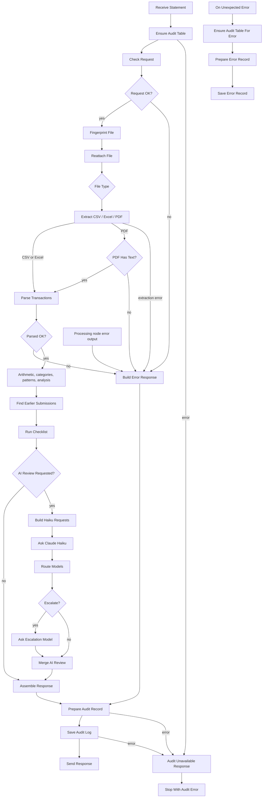

# Architecture

**Author:** Hasan Gaffar

The Bank Statement Verification API is a single n8n workflow. It answers one question: do the accounts add up and, if not, where and why?

## Design goals

| Goal | How the design meets it |
|---|---|
| Deterministic verification | Code computes every figure, check result and verdict. Date-dependent checks use `as_of_date`, which defaults to the current UTC date. The duplicate-submission check also depends on earlier audit rows. |
| AI is advisory only | The optional AI review can add notes and raise concerns. It cannot change a check result, a figure or the verdict. Concerns and missing reviews are listed for manual handling, which sets `processing.straightThrough` to `false`. |
| Nothing silently dropped | Parsers separate rows into transactions and rejected lines, apart from recognised blank, opening, summary, heading and page text. A PDF line carrying an amount and a balance is parsed or reported; an isolated undated line with a single amount is not reported. Rejected lines are counted by the checks and returned in `unreadLines` (first 50). |
| No response without an audit record | Success and handled errors both pass through `Save Audit Log` before `Send Response`. If the record cannot be prepared or saved, the caller gets 500 `AUDIT_UNAVAILABLE` and no result. A crashed processing node gives 500 `UNEXPECTED_ERROR`. See [Unexpected failures](#unexpected-failures). |

## Configuration with .env

`scripts/config.js` loads the optional `.env` file in the project root with `process.loadEnvFile` (real environment variables win) and resolves paths with Node's `path` and `os` modules. Relative paths start at the project root. It is used by `npm run verify` (`scripts/verify.js`) and `npm run e2e` (`scripts/e2e.js`), so each user can point them at their own files and n8n instance without editing code. Workflow Code nodes do not read `.env`, and the Anthropic API key is not stored there: it is an n8n credential. Copy `.env.example` to start; the variables are listed in [API.md](API.md#configuration-with-env).

## Flow



## Nodes in flow order

Canvas sticky notes are documentation only and are not listed.

| Node | Type | Role |
|---|---|---|
| Receive Statement | Webhook | Accepts `POST verify-statement`; the response is sent by a later node. No webhook authentication is configured in the build script. |
| Ensure Audit Table | Data Table | Creates `statement_audit_log` if it does not exist. |
| Check Request | Code | Validates the upload and fields; records the start time. |
| Request OK? | If | Sends invalid requests to the error path. |
| Fingerprint File | Crypto | Computes the SHA-256 of the file. |
| Reattach File | Code | Restores the binary file, because the hash node returns only JSON. |
| File Type | Switch | Selects CSV, XLSX or PDF by file name extension. |
| Extract CSV / Extract Excel / Extract PDF | Extract From File | Reads the file. Each has a separate error output. |
| PDF Has Text? | If | PDF only: requires at least 50 characters of trimmed text. |
| Parse Transactions | Code | Produces the common transaction format; limits transactions plus rejected lines to 20,000. |
| Parsed OK? | If | Sends parsing failures to the error path. |
| Check Arithmetic | Code | Checks running balances and totals; diagnoses faults. |
| Categorize Transactions | Code | Applies rule-based categories. |
| Detect Patterns | Code | Detects patterns that a person may need to review; these are not proof of fraud. |
| Analyse Account | Code | Computes period, balances, monthly flow and category totals. |
| Find Earlier Submissions | Data Table | Reads audit rows with the same SHA-256. |
| Run Checklist | Code | Sets the reference and runs the checklist. A successful earlier row for the same file under a different, non-empty account holder name is passed to the checklist as a duplicate. |
| AI Review Requested? | If | True only when `ai_review` is `true`. |
| Build Haiku Requests | Code | Builds one request per checklist section. |
| Ask Claude Haiku | HTTP Request | Calls the Anthropic Messages API. |
| Route Models | Code | Computes the verdict for routing and builds any second-stage requests. |
| Escalate? | If | Skips the second stage when no request is needed. |
| Ask Escalation Model | HTTP Request | Calls the selected Sonnet or Opus model. |
| Merge AI Review | Code | Merges notes, concerns, failures and usage. |
| Assemble Response | Code | Decides the verdict and builds the response. |
| Build Error Response | Code | **Error path.** Receives invalid requests, extraction errors, PDFs without enough text, parsing failures and processing node error outputs. |
| Prepare Audit Record | Code | Common to success and error paths; flattens the outcome into one row. |
| Save Audit Log | Data Table | Inserts the row. |
| Send Response | Respond to Webhook | Returns the stored JSON plus `audit {table, rowId, loggedAt}` with the recorded HTTP status. |
| Audit Unavailable Response | Respond to Webhook | Returns 500 `AUDIT_UNAVAILABLE` when `Ensure Audit Table`, `Prepare Audit Record` or `Save Audit Log` fails. |
| Stop With Audit Error | Stop And Error | Then fails the execution, which triggers the safety net. |
| On Unexpected Error | Error Trigger | **Unexpected failures.** Starts when a published webhook execution fails. |
| Ensure Audit Table For Error | Data Table | Creates `statement_audit_log` if it does not exist. |
| Prepare Error Record | Code | Builds the audit row for the failure. |
| Save Error Record | Data Table | Inserts that row. |

Both Claude nodes have a 120-second timeout, up to 3 tries with 3 seconds between them, and continue on error, so an AI failure is reported in `aiReview` while verification completes.

## PDF text interpretation (`src/parse-pdf.js`)

Only extracted text is used; column positions are not available, and OCR is not included.

- A record starts with a dated line and may span several lines. It is complete once it has at least two amount fields, normally the amount(s) and the balance. Amounts printed without a space between them are separated.
- Descriptions may come before the amounts or, when amounts directly follow the date, after them (at most 6 trailing lines). A line beginning with a time after the date does not start a new record.
- A trailing `DR` marker makes the balance negative.
- Records printed newest first are reversed.
- When both debit and credit columns are printed, the column order is learned from balance movements across the statement. It needs at least 3 informative rows with at least 80% agreement, and is then applied to every such row, so a wrong column can still be detected.
- With a single amount, debit or credit follows the balance movement. If neither direction fits, the direction of travel is used and the balance check reports the difference. With no previous balance, wording in the description decides.
- Negative amounts that match the balance movement are kept as reversals. If every non-zero value in a column is negative (more than one value), the sign is treated as bank notation.
- Summary figures are read beside or just after their labels. When a block of labels is separated from its figures, `src/validate.js` matches figures to calculated totals. A single remaining label and figure are paired; more are reported as unexplained.
- A line carrying an amount and a balance is parsed or reported as rejected, as is a dated record with an amount that cannot form a transaction. An isolated undated line with a single amount is not reported.
- Fewer than 2 recognised records produces `LAYOUT_NOT_SUPPORTED`.

## Fault diagnosis (`src/validate.js`)

For each row, `expected = previous balance + credit - debit`, with a tolerance of 0.01. `difference` is the shown balance minus the expected balance. Without a stated opening balance, the first row is not checked. The first matching cause applies:

| Cause | Condition |
|---|---|
| `WRONG_BALANCE_FIGURE` | The next row differs by the same amount in the opposite direction. The pair is reported once. |
| `DUPLICATED_LINE` | Date, description, debit, credit and balance all repeat the previous row. |
| `DEBIT_CREDIT_SWAPPED` | The difference is twice the amount, with the sign expected for a swap. |
| `WRONG_AMOUNT_OR_MISSING_ENTRY` | None of the above. |

The cause is a likely explanation, not a proven one. The module also calculates totals, the closing balance, date-order breaks and the longest gap.

## Verdict (`src/assemble.js`)

The first matching rule wins.

| Verdict | Condition |
|---|---|
| `INCONCLUSIVE` | No balance can be checked; or at least 3 faults make up more than 50% of balance checks; or more than 20% of rows are rejected. |
| `FAULTS_FOUND` | Any `HIGH` discrepancy. |
| `REVIEW_REQUIRED` | Any `MEDIUM` discrepancy. |
| `VERIFIED` | Otherwise. |

`accountsCorrect` is `null` for `INCONCLUSIVE`. Otherwise it is `false` if any section B check is a discrepancy, `null` if there is none but some rows were rejected, and `true` in all other cases. `VERIFIED` can still require manual handling, for example after an AI concern. See [STATEMENT_RULES.md](STATEMENT_RULES.md) for the checks.

## AI model routing (`src/ai.js`)

**Stage 1:** `claude-haiku-5-5` reviews every section.

**Stage 2** (`chooseRoute`): first, the candidate sections are the union of:

- sections with a `HIGH` or `MEDIUM` item;
- sections where a usable Haiku reply raised at least one concern;
- sections where Haiku gave no usable answer.

| Order | Condition | Tier and model | Sections sent |
|---|---|---|---|
| 1 | Balance fault count is 3 or more, **or** printed summary figures are unexplained, **or** the verdict is `INCONCLUSIVE` | `ESCALATED_OPUS`, `claude-opus-5-5` | Candidates; all sections if there are none |
| 2 | Otherwise, at least one candidate | `ESCALATED_SONNET`, `claude-sonnet-5-5` | Candidates |
| 3 | Otherwise | `HAIKU_ONLY` | None |

One model is selected for the second stage. A usable second-stage answer replaces Haiku's answer for that section; if it fails, a usable Haiku answer is kept and the section is listed in `failedSections`. Status is `UNAVAILABLE` when no call gave a usable answer, `PARTIAL` when any section is in `failedSections`, and otherwise `COMPLETED`. A reply must end with `end_turn` and contain JSON with `notes` and `concerns` arrays.

Requests include section results and remarks, up to 30 transactions (rows named by checks first, then the largest), up to 20 faults for section B, and for stage 2 any usable first review. The account holder name and caller reference are not sent as dedicated fields, but transaction descriptions or check remarks may contain names or other sensitive text. The system prompt tells the model to treat descriptions as untrusted data. Cost is an estimate from the price table in the source.

## Audit table: `statement_audit_log`

| Column | Type | Content |
|---|---|---|
| `received_at` | string | Processing start time (ISO 8601) |
| `reference` | string | Response reference |
| `account_holder` | string | Supplied account holder |
| `file_name` | string | Uploaded file name |
| `file_type` | string | File extension |
| `sha256` | string | File hash; empty if rejected before hashing |
| `http_status` | number | Response status |
| `success` | boolean | Success flag |
| `verdict` | string | Verdict; empty on error |
| `accounts_correct` | string | `true`, `false` or `unknown` |
| `transaction_count` | number | Parsed transactions; 0 on error |
| `fault_count` | number | Balance faults; 0 on error |
| `discrepancy_ids` | string | Comma-separated check IDs |
| `error_code` | string | Error code, if any |
| `ai_status` | string | AI review status |
| `ai_route` | string | Routing tier |
| `ai_models` | string | Models reported as having answered |
| `ai_input_tokens` | number | Input tokens |
| `ai_output_tokens` | number | Output tokens |
| `ai_cost_usd` | number | Estimated AI cost |
| `duration_ms` | number | Time from request checking until the audit record is prepared; excludes the final save and send |
| `execution_id` | string | n8n execution ID |
| `response_json` | string | Full response, without the `audit` object |
| `transactions_json` | string | Transactions as JSON; `[]` on error |
| `error_message` | string | Error message, if any |
| `failed_node` | string | Node that failed, for an unexpected failure |
| `ai_duration_ms` | number | Duration of the AI review |
| `ai_errors` | string | AI failures |
| `ai_usage_json` | string | Per-stage models, sections, input and output tokens, estimated cost and failures |

When request validation fails, `account_holder` and `file_type` are empty, even if they were sent. Every response, success or handled error (except `AUDIT_UNAVAILABLE`), carries `processing.durationMs`, and `aiReview.durationMs` when a review ran.

### Unexpected failures

These processing nodes route their error output to `Build Error Response`: `Fingerprint File`, `Reattach File`, `Parse Transactions`, `Check Arithmetic`, `Categorize Transactions`, `Detect Patterns`, `Analyse Account`, `Find Earlier Submissions`, `Run Checklist`, `Build Haiku Requests`, `Route Models`, `Merge AI Review` and `Assemble Response`. A crash there returns 500 `UNEXPECTED_ERROR` without internal detail; the audit row has `failed_node` and `error_message`. (Extraction errors use the same path but return 422; the Claude nodes continue on error.)

`Ensure Audit Table`, `Prepare Audit Record` and `Save Audit Log` route their error output to `Audit Unavailable Response`. It returns 500 `AUDIT_UNAVAILABLE` and no result; `Stop With Audit Error` then triggers the safety net below, so a row is written if the database allows.

Clients must treat any response without a boolean `success` field as a failure.

`On Unexpected Error` (Error Trigger) -> `Ensure Audit Table For Error` -> `Prepare Error Record` -> `Save Error Record` writes a row with `success=false`, `http_status=500`, `error_code=UNEXPECTED_ERROR`, `error_message`, `failed_node` and `execution_id`. The row's `reference` is `ERR-<execution ID>` (a timestamp replaces a missing ID), and its `received_at` is the time the record is prepared. Because the workflow contains an Error Trigger, it is its own error workflow. Such rows have no file details or duration. This works for published webhook executions, not manual editor runs. If the database itself is unavailable, only the server log remains.

### Where records are stored

The Data Table lives in n8n's own database (SQLite by default, in the n8n user folder). This project does not encrypt it at rest. Uploaded files are also kept in n8n's execution storage. In the n8n version used for the README measurements (2.35.7), the default Data Table size limit is 200 MB (`N8N_DATA_TABLES_MAX_SIZE_BYTES`).

The table holds financial and personal data, and the workflow settings also save execution data and progress. The build script defines no retention or deletion step; set access and retention controls in the deployment.

## Single source of truth

`src/` holds the logic and `scripts/build-workflows.js` defines the nodes and connections. After a change, run:

```bash
node scripts/build-workflows.js
```

For each Code node, the script concatenates the required modules, removes their import and export sections, and appends the node's own code. It writes `workflows/bank-statement-verifier.json` and `docs/STATEMENT_RULES.md` (from `src/checklist.js`). Do not edit generated files by hand. Re-import the workflow into n8n after rebuilding. `src/engine.js` chains the same verification modules outside n8n, without the AI review.
